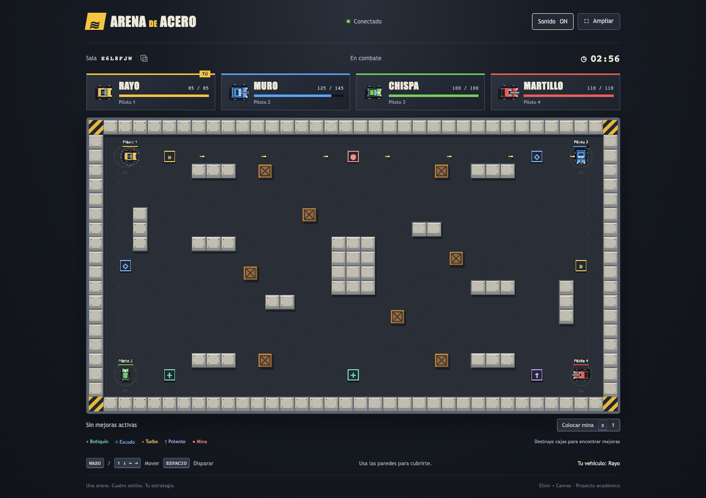

# Arena de acero

**Proyecto final de LP · Entrega final · Versión 1.0.0**

Combate vehicular 2D para **cuatro jugadores reales**, con servidor autoritativo en **Elixir/OTP** y gráficos originales en Canvas. No necesita cuentas, base de datos, imágenes externas ni un compilador de JavaScript.



## Documentos de entrega final

- [Informe final](docs/final/Informe_final_Arena_de_acero.pdf): juego, diagrama, concurrencia, funciones y validación.
- [Manual de Elixir](docs/final/Manual_Elixir_final.pdf).
- [Conexión con compañeros por LAN](docs/final/Conexion_multijugador.md).
- [Avance II conservado](docs/entrega/Avance_II_Arena_de_acero.pdf) y etiqueta Git `avance-ii`.

Esta versión incorpora una arena de 1440 × 800, ocho cajas destructibles y cinco tipos de objeto: vida, escudo, turbo, munición potente y carga de mina. La prueba individual funciona sin bots; la partida admite cuatro personas.

## Ejecutar

Requiere Elixir y Erlang/OTP. Probado con Elixir 1.20.5 y OTP 29; se recomienda Elixir 1.18 o superior con una versión compatible de OTP.

En macOS, para instalar Elixir: `brew install elixir`.

Desde esta carpeta:

```sh
mix local.hex --force   # solo la primera vez
mix deps.get
mix run --no-halt
```

Abre **http://localhost:4000**. También puedes hacer doble clic en **iniciar.command** en macOS o ejecutar `bash scripts/iniciar.sh`. En Windows, con Elixir instalado y disponible en PATH, utiliza `iniciar.bat`.

Para detenerlo, pulsa Ctrl+C dos veces en la terminal. Para cambiar el puerto: `PORT=4100 mix run --no-halt`.

La primera descarga de dependencias necesita internet. Después el juego funciona dentro de tu red local sin servicios externos. Node.js solo se utiliza para las pruebas, no para jugar.

## Probar el movimiento durante la revisión

Pulsa **Probar movimiento**. Entrarás de inmediato a una arena privada con un solo vehículo, sin bots, rivales, cuenta atrás ni condición de victoria. Las cajas y mejoras también están disponibles para demostración. El tiempo aparece como Libre. Puedes revisar WASD, flechas, paredes y disparo básico. Pulsa **Salir de práctica** para volver al menú.

El navegador enfoca la arena al entrar. Si has cambiado de ventana, haz clic sobre ella para recuperar el control. El vehículo se detiene al perder el foco.

Esta opción es una herramienta de demostración; no sustituye la prueba multijugador con cuatro personas.

## Cómo jugar con amigos

1. Escribe tu nombre, elige un vehículo y entra a una sala.
2. Los otros tres jugadores usan **el mismo código de sala** y eligen los vehículos restantes. Puedes copiar el enlace de invitación.
3. Cada piloto pulsa **Estoy listo**. Con cuatro preparados empieza una cuenta atrás de tres segundos.
4. Muévete con **WASD o las flechas**. Dispara con **Espacio** hacia la última dirección y coloca una mina detrás del carro con **E** o el botón Mina. No hay giro libre ni disparos diagonales.
5. Las paredes bloquean carros y proyectiles. Las cajas también bloquean el paso, pero se destruyen con disparos y dejan una mejora. Los impactos reducen la vida; al llegar a cero observas el resto de la ronda.
6. Gana el último vehículo activo. Si nadie sobrevive, o acaba el tiempo con varios supervivientes, hay empate.
7. **Volver al lobby** devuelve a todos los conectados al garaje para preparar otra ronda.

Activa el sonido voluntariamente con el botón superior. En pantallas pequeñas aparecen controles táctiles durante el combate. Se recomienda jugar con teclado.

### Cuatro computadoras en una red

Todas deben estar en la misma Wi-Fi o LAN. Una ejecuta Elixir; las otras solo abren un navegador. En macOS puedes consultar la IP local con:

```sh
ipconfig getifaddr en0
```

Si devuelve `192.168.1.25`, todos abren `http://192.168.1.25:4000` y usan el mismo código. El anfitrión también debe abrir esa dirección antes de copiar la invitación: `localhost` solo funciona en su propia computadora. Si Wi-Fi no utiliza `en0`, consulta Ajustes del Sistema → Wi-Fi → Detalles → Dirección IP.

El servidor escucha en `0.0.0.0`. Permite conexiones entrantes de Erlang si macOS lo solicita. Algunas redes de campus aíslan dispositivos; utiliza una red que permita comunicación entre equipos.

### Probar en una computadora

Abre cuatro pestañas con el mismo enlace. Escribe cuatro nombres, elige cuatro vehículos y marca listo en todas. Controlas la pestaña activa; al cambiar de ventana, el carro deja de moverse y disparar. En este modo las cuatro conexiones representan jugadores reales. Para revisar movimiento sin abrir otras pestañas, usa Probar movimiento.

## Objetos, cajas y minas

Pasa por un objeto para recogerlo. Los puntos fijos reaparecen después de 450 ticks (unos 15 segundos). Los objetos de cajas se consumen una sola vez. Los eliminados no recogen objetos.

| Objeto | Efecto |
|---|---|
| Botiquín + | Recupera hasta 30 de vida, sin superar el máximo. No se consume si ya tienes vida completa. |
| Escudo ◇ | Absorbe exactamente un impacto. No se acumulan escudos. |
| Turbo » | +35 % de velocidad durante 180 ticks, unos 6 segundos. Otra recogida renueva su duración. |
| Potente ↑ | Cinco disparos con +50 % de daño; reemplaza la reserva anterior, sin acumularla. |
| Mina ● | Recarga una mina, hasta una carga. Cada vehículo empieza con una. |

Las ocho cajas tienen 40 de vida. Paredes y cajas bloquean el desplazamiento y las balas. Al destruir una caja aparece su objeto: abrir rutas te permite acceder a mejoras.

**Minas:** E coloca una a 30 píxeles detrás del carro si hay espacio. Se arma después de 30 ticks (aproximadamente un segundo), dura hasta 900 ticks y se activa cuando un rival pasa a 26 píxeles. La explosión causa 45 de daño en un radio de 75 píxeles; paredes y cajas bloquean la onda. También puede herir a su dueño si está cerca de un rival al activarse. Solo se permite una mina activa por jugador, aunque recoja otra carga. En práctica no hay rivales que la activen: sirve para mostrar colocación, armado y caducidad.

Los efectos y la carga aparecen bajo la arena. Los cálculos son del servidor; los clientes no pueden asignarse objetos o daño.

## Vehículos

| Personaje | Vehículo | Vida | Velocidad por tick | Daño | Recarga en ticks |
|---|---|---:|---:|---:|---:|
| Rayo | Buggy ligero | 85 | 4.2 | 20 | 14 |
| Muro | Blindado pesado | 145 | 2.6 | 20 | 17 |
| Chispa | Auto de combate | 100 | 3.5 | 12 | 8 |
| Martillo | Camioneta artillera | 110 | 3.0 | 34 | 26 |

Un tick dura aproximadamente 33 ms. La ronda dispone de 5400 ticks, unos tres minutos de simulación. El balance se ajusta en `Arena.Reglas.personajes/0`.

## Arquitectura para la exposición

```text
Navegador 1   Navegador 2   Navegador 3   Navegador 4
     ↕             ↕             ↕             ↕
                   WebSockets
     ↕             ↕             ↕             ↕
 Socket 1      Socket 2      Socket 3      Socket 4
     └─────────────┴──────┬──────┴─────────────┘
                   Partida GenServer
                    ↕ llamadas
                    Reglas puras
```

- **BEAM** ejecuta Elixir y programa los procesos ligeros. Todos pueden ejecutarse en una computadora.
- **Bandit + Plug** sirven la interfaz y la ruta `/ws`.
- **Arena.Socket** implementa WebSock. Cada conexión tiene un proceso, una identidad y un monitor de sala: es el proceso del jugador del diagrama.
- **Arena.Partida** es el GenServer por sala. Recibe acciones, mantiene el estado autorizado, avanza la simulación y envía la misma actualización a los cuatro clientes.
- **Arena.Reglas** contiene funciones puras. Reciben mapas y devuelven nuevos mapas sin modificarlos; no abren conexiones, consultan relojes ni envían mensajes. Resuelven movimiento, colisiones, disparos, daño y victoria.
- **Registry + DynamicSupervisor** localizan y supervisan salas. Los monitores detectan desconexiones; las salas vacías terminan.
- **Canvas** dibuja mapa, carros, balas y efectos. JavaScript captura controles, sin decidir posiciones, impactos ni daño. Interpola posiciones recibidas para suavizar el dibujo.

Los nombres combinan español con términos técnicos: `estado_partida`, `jugadores`, `player_id`, `cooldown_ticks`, `socket_pid` y `velocidad_base`.

### Archivos principales

```text
lib/arena/
  application.ex    Supervisión y servidor HTTP
  router.ex         Archivos estáticos y upgrade WebSocket
  salas.ex          Localización y creación de salas
  socket.ex         Proceso por cliente y mensajes
  partida.ex        Coordinador y tick de la sala
  reglas.ex         Estado inmutable y reglas puras
  objetos.ex        Mejoras, cajas, escudos y minas como funciones puras
priv/static/
  index.html        Garaje, HUD y pantallas de partida
  estilos.css       Diseño responsive
  juego.js          Conexión, controles, interfaz y sonido
  render.js         Sprites, mapa y renderizado
```

## Desconexiones y límites

- En lobby, salir libera el vehículo y cancela la cuenta atrás.
- En combate, desconectarse elimina el vehículo. No se admiten jugadores en una ronda ya iniciada.
- Recargar equivale a salir: no se recupera el vehículo anterior. Se puede entrar cuando la sala vuelva al lobby o usar otro código.
- Reiniciar Elixir borra las salas. Si el actor de sala termina inesperadamente, los clientes reciben un aviso y pueden recargar.
- Hasta 32 salas, cuatro pilotos por sala. Es un proyecto académico para demostración local/LAN; no incluye cuentas ni matchmaking público.
- Arena fija de 1440 × 800, paredes indestructibles, cajas y objetos. Sin bots, cuentas ni recuperación de sesión después de una desconexión. Sprites originales; no se extraen recursos de otras franquicias.

## Verificar

```sh
mix format --check-formatted
mix compile --warnings-as-errors
mix test
```

Con el servidor ejecutándose en el puerto 4000:

```sh
npm ci
npx playwright install chromium
npm run test:network
npm run test:e2e
```

Las pruebas de red requieren Node.js 22 o superior. Puedes utilizar otro puerto con `ARENA_URL=http://127.0.0.1:4100 npm run test:network`. Playwright se configura para el puerto 4000.

Se comprueban exclusividad, quinta conexión, cuenta atrás, paredes y carros, cadencia, daño, eliminación simultánea, empate, victoria, controles caducados, cuatro estados idénticos, mensajes inválidos, desconexiones, revancha y prueba individual de movimiento con WASD. También se verifican curación, escudo, expiración de turbo, cinco disparos potentes, cajas, minas, reaparición, recogida simultánea y reinicio sin efectos residuales. Las capturas se guardan en `test-results/`.

## Regenerar los documentos

Los PDFs finales incluyen fuentes Markdown editables en docs/final; los avances permanecen en docs/entrega. Para regenerarlos con el script se necesita Python, reportlab y Pillow, solo para documentación:

```sh
python -m pip install reportlab pillow
python scripts/generar_entrega_final.py
```

El script utiliza Trebuchet si está instalada en macOS; en otros sistemas utiliza Helvetica. El juego no necesita estas dependencias de Python.

## Documentación técnica consultada

- [Bandit](https://hexdocs.pm/bandit/Bandit.html)
- [WebSock](https://hexdocs.pm/websock/WebSock.html)
- [WebSockAdapter](https://hexdocs.pm/websock_adapter/WebSockAdapter.html)
- [GenServer](https://hexdocs.pm/elixir/GenServer.html)
- [Supervisor](https://hexdocs.pm/elixir/Supervisor.html)

El juego y sus sprites son originales, inspirados en el combate vehicular arcade de la propuesta académica.
