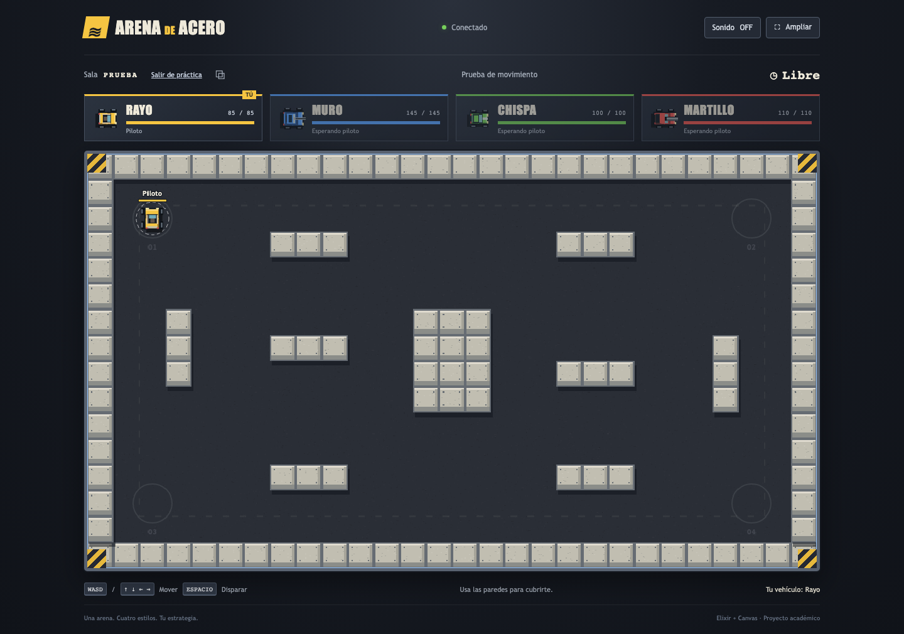

AVANCE II · LENGUAJES DE PROGRAMACIÓN

# Arena de acero

Prototipo multijugador en Elixir · Versión 0.2.0

## 1  Presentación y objetivo

Arena de acero es un juego de combate vehicular 2D visto desde arriba. Cuatro jugadores conducen vehículos distintos dentro de una arena con paredes, se cubren y disparan en cuatro direcciones. Los impactos reducen la vida y gana el último vehículo activo. La ronda termina en empate si no queda un ganador único.

El objetivo de este avance es demostrar el núcleo funcional del proyecto: estado compartido, conexiones simultáneas, movimiento, paso de mensajes y reglas puras en Elixir. Se entrega como versión intermedia para el hito mínimo del 50 %, no como versión final terminada. El porcentaje es una referencia del enunciado, no una medición exacta de funciones completadas.

## 2  Alcance implementado

| Componente | Estado del avance |
| --- | --- |
| Sala y jugadores | Código de sala, cuatro pilotos y selección exclusiva de vehículo. |
| Juego básico | Movimiento, paredes, proyectiles, daño, eliminación y reinicio de ronda. |
| Concurrencia | Proceso por conexión y GenServer coordinador por sala. |
| Prueba individual | Un vehículo sin rivales para revisar controles; sin bots ni espera. |
| Validación pendiente | Prueba presencial en cuatro computadoras y ajuste del balance. |

## 3  Vehículos y controles

| Personaje | Vehículo | Diferencia principal |
| --- | --- | --- |
| Rayo | Buggy | Rápido, con menor resistencia. |
| Muro | Blindado | Más vida y menor velocidad. |
| Chispa | Auto de combate | Disparo frecuente y menor daño por impacto. |
| Martillo | Camioneta | Más daño y mayor tiempo entre disparos. |

WASD o flechas permiten moverse; Espacio dispara hacia la última dirección. El desplazamiento se actualiza en pasos de simulación, con cuatro orientaciones y sin giro libre. El navegador enfoca la arena al entrar; al perder el foco, los controles se detienen.


---

## 4  Estructura del juego

El servidor concentra las decisiones de la partida. Cada navegador envía intenciones de movimiento y disparo, pero no posiciones, daño ni resultados. El coordinador aplica las reglas y distribuye un mismo estado a los clientes.

Navegadores ↔ WebSockets ↔ procesos Socket ↔ GenServer de partida ↔ reglas puras.

Figura 1. Comunicación de cuatro jugadores con el coordinador de la partida.

| Módulo | Responsabilidad |
| --- | --- |
| Arena.Application | Inicia supervisión, registro de salas y servidor HTTP. |
| Arena.Router y Arena.Socket | Sirven la interfaz y reciben mensajes WebSocket por jugador. |
| Arena.Salas | Localiza o crea la sala solicitada. |
| Arena.Partida | Coordina acciones, bucle de simulación y envío de estados. |
| Arena.Reglas | Calcula movimiento, colisiones, daño y final con funciones puras. |

## 5  Concurrencia y sincronización

Elixir se ejecuta sobre BEAM. Las conexiones se atienden en procesos ligeros y cada sala tiene un GenServer independiente. El coordinador procesa sus mensajes de forma secuencial, lo que evita que dos clientes modifiquen simultáneamente su estado autorizado. La simulación avanza aproximadamente cada 33 ms.

Un movimiento recorre esta secuencia: tecla en el navegador, mensaje WebSocket, proceso del jugador, coordinador, cálculo de un nuevo estado y difusión a las cuatro pantallas. Los monitores detectan desconexiones y las salas vacías terminan. Una desconexión durante combate elimina al vehículo; recargar no recupera automáticamente la sesión.

Los datos del juego se representan mediante mapas y listas inmutables. Las operaciones de red y temporización quedan en los procesos; las reglas reciben datos y devuelven nuevos datos. Esta separación permite verificar la lógica sin abrir navegadores.


---

## 6  Funciones principales

| Función de Arena.Reglas | Propósito |
| --- | --- |
| nueva/0 | Construye el estado inicial de la sala. |
| agregar/4 | Valida y registra un jugador y su vehículo. |
| accion/3 | Gestiona selección, preparado y revancha. |
| input/4 | Registra una intención válida de movimiento y disparo. |
| tick/1 | Avanza la simulación y calcula colisiones, daño y final. |
| quitar/2 y snapshot/1 | Gestionan salida y preparan el estado enviado a clientes. |

## 7  Evidencia y verificación



Figura 2. Prueba individual real: un solo vehículo, sin rivales y con tiempo libre. Utiliza el mismo servidor y las mismas reglas de movimiento que el multijugador.

La verificación automatizada pasó 14 pruebas ExUnit, una prueba de WebSockets reales y cuatro pruebas de navegador. Se comprobó movimiento con W, A, S y D, límites y paredes, daño y cadencia, selección exclusiva, quinto jugador rechazado, cuenta atrás, cuatro clientes con el mismo estado, desconexión, victoria, empate y revancha.

Las pruebas de cuatro clientes se ejecutaron en una computadora; no equivalen a haber validado cuatro equipos físicos en la red del aula. La revisión presencial debe completar esa comprobación. El código incluye las pruebas y las instrucciones para repetirlas.


---

## 8  Cómo conectarnos con los compañeros

Se necesitan cuatro navegadores y una red Wi-Fi o LAN que permita comunicación entre equipos. Solo la computadora anfitriona instala Elixir y Erlang/OTP. Las demás ejecutan el cliente en el navegador. GitHub almacena el proyecto; no ejecuta este servidor de juego.

Paso 1. El anfitrión abre una terminal en la carpeta del proyecto, instala las dependencias e inicia el servidor. Debe dejar la terminal abierta mientras juegan.

```elixir
mix local.hex --force   # solo al configurar Hex
mix deps.get
mix run --no-halt
```

Paso 2. Consultar la IP local del anfitrión: en macOS, ipconfig getifaddr en0 o los detalles de Wi-Fi; en Windows, ipconfig y Dirección IPv4; en Linux, hostname -I. Si el adaptador no es en0, se consulta la dirección desde la configuración de red.

Paso 3. Los cuatro abren la IP real y el puerto 4000. Ejemplo ilustrativo: http://192.168.1.25:4000. No se debe escribir localhost en las otras computadoras, porque apuntaría a ellas mismas. El anfitrión también usa su IP LAN antes de copiar una invitación.

Paso 4. Todos introducen el mismo código, por ejemplo AULA01, eligen vehículos distintos y pulsan Estoy listo. La ronda empieza cuando los cuatro están preparados. Para esta prueba se utiliza Entrar a la sala; Probar movimiento es solo para demostrar un vehículo.

| Si ocurre esto | Comprobar |
| --- | --- |
| No abre la página | Servidor activo, misma red, IP correcta y puerto 4000. |
| El anfitrión entra y los demás no | Permisos entrantes de Erlang en firewall o aislamiento de clientes en Wi-Fi. |
| No responde el teclado | Hacer clic en la arena, comprobar foco y utilizar WASD o flechas. |
| Están en redes distintas | Se requiere despliegue en internet, fuera de esta entrega LAN. |

## 9  Trabajo para la entrega final

Se mantiene un alcance intermedio: una arena fija, paredes indestructibles y disparo básico. Quedan para una siguiente iteración la ampliación del mapa, objetos de recuperación de vida, armamento adicional y una revisión del balance. Antes de añadirlos se validará la experiencia con cuatro compañeros en equipos físicos.

La entrega se complementa con el Manual de Elixir y la guía de conexión en Markdown. El repositorio incluye código fuente, dependencias fijadas, instrucciones y pruebas reproducibles.

Repositorio: https://github.com/memo-dev-gcc/proyecto-final-de-lp
Referencia técnica: documentación oficial de Elixir, GenServer y WebSock; enlaces completos en el manual.
