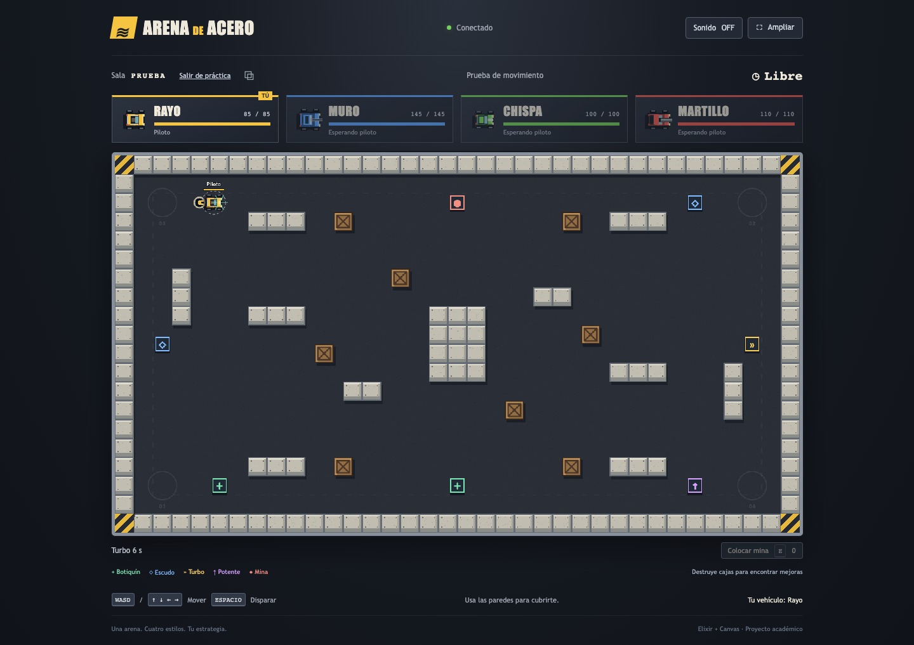

ENTREGA FINAL · LENGUAJES DE PROGRAMACIÓN

# Arena de acero

Juego multijugador en Elixir · Versión 1.0.0

## 1  Descripción y objetivo

Arena de acero es un juego de combate vehicular 2D para cuatro jugadores simultáneos. Cada piloto conduce un vehículo con atributos propios, aprovecha coberturas, recoge mejoras y combate en una arena compartida. El objetivo es sobrevivir hasta ser el último vehículo activo.

El proyecto implementa un servidor autoritativo en Elixir con estructuras inmutables, funciones puras y procesos que se comunican mediante mensajes. La interfaz HTML/Canvas permite observar posiciones, acciones, proyectiles y efectos de los demás jugadores en tiempo real.

## 2  Dinámica de la partida

Los jugadores entran con el mismo código de sala, eligen vehículos distintos y marcan Estoy listo. Con cuatro preparados comienza una cuenta atrás. WASD o flechas desplazan el carro en cuatro direcciones; Espacio dispara hacia su última orientación y E coloca una mina detrás.

Las paredes bloquean el movimiento y los disparos. Las cajas también bloquean el paso, pero pueden destruirse para abrir rutas y obtener objetos. Los impactos reducen vida; al llegar a cero, el jugador queda como observador. Gana el último superviviente. Si no queda nadie o el tiempo termina con varios vivos, hay empate.

## 3  Personajes y balance inicial

| Personaje | Vida | Velocidad | Daño | Recarga |
| --- | --- | --- | --- | --- |
| Rayo | 85 | 4.2 | 20 | 14 ticks |
| Muro | 145 | 2.6 | 20 | 17 ticks |
| Chispa | 100 | 3.5 | 12 | 8 ticks |
| Martillo | 110 | 3.0 | 34 | 26 ticks |

Velocidad en píxeles por tick; simulación aproximada de 33 ms por tick. La ronda dispone de 5400 ticks, unos tres minutos. Estos valores pueden ajustarse tras partidas con el grupo.

## 4  Alcance de la versión final

La arena se amplió a 1440 × 800 e incorpora ocho cajas, puntos de objetos que reaparecen, mejoras temporales y minas. Se conserva la prueba individual sin bots: permite revisar movimiento, paredes, disparos, cajas, recogidas y colocación de minas sin esperar a otros jugadores. No reemplaza la demostración multijugador.

La entrega contiene código fuente, dependencias fijadas, pruebas, instrucciones de ejecución y conexión por red local, manual de Elixir e informe técnico. El Avance II se conserva mediante su etiqueta y documentos originales.


---

## 5  Objetos e interacciones

Los objetos se recogen al pasar sobre ellos. Los puntos fijos vuelven a estar disponibles 450 ticks después de recogerse; los objetos de una caja se consumen una sola vez. La misma recogida solo beneficia a un jugador. Los eliminados no pueden recoger mejoras.

| Objeto | Efecto y límite |
| --- | --- |
| Botiquín | Recupera hasta 30 de vida sin superar el máximo; no se consume con vida completa. |
| Escudo | Absorbe un impacto. Otro escudo no se acumula. |
| Turbo | Aumenta la velocidad un 35 % durante 180 ticks. Recoger otro renueva la duración. |
| Munición potente | Cinco disparos con un 50 % más de daño. La nueva reserva reemplaza a la anterior. |
| Carga de mina | Recupera una carga hasta un máximo de una. Cada carro empieza con una. |

Cada caja tiene 40 de vida y deja una mejora al destruirse. Las minas se colocan a 30 píxeles detrás del vehículo si hay espacio libre y no tiene otra mina activa. Tardan 30 ticks en armarse y caducan a los 900 ticks.

Un rival que pase a 26 píxeles activa la mina. La explosión causa 45 de daño a vehículos en un radio de 75 píxeles, incluido el dueño si está cerca. Paredes y cajas bloquean la onda. En prueba individual no hay rivales que la activen; se puede demostrar su colocación, armado y caducidad.



Figura 1. Captura real de la prueba individual: turbo activo y mina colocada. El HUD indica mejoras y carga; el mapa distingue cajas, objetos y paredes.


---

## 6  Diagrama de la estructura del juego

Cada navegador conserva una conexión WebSocket con el servidor. El proceso asociado a esa conexión representa al jugador y envía sus acciones al coordinador. Todos los clientes reciben el estado calculado por la misma sala.

Navegadores ↔ WebSockets ↔ procesos Socket ↔ GenServer de partida ↔ reglas puras.

Figura 2. Procesos de los jugadores y coordinador. Arena.Reglas utiliza Arena.Objetos como parte de los cálculos puros de simulación.

| Componente | Responsabilidad |
| --- | --- |
| Arena.Application | Inicia el supervisor, Registry, DynamicSupervisor y HTTP. |
| Arena.Router y Arena.Socket | Sirven la interfaz, validan mensajes e identifican la conexión. |
| Arena.Salas | Localiza salas existentes o crea su coordinador. |
| Arena.Partida | GenServer de sala: procesa acciones, programa ticks y difunde snapshots. |
| Arena.Reglas | Movimiento, colisiones, proyectiles, daño y resultado. |
| Arena.Objetos | Recogidas, efectos, cajas, escudos y minas. |

## 7  Estrategia de concurrencia

BEAM administra los procesos ligeros. Existe un proceso de conexión por cliente y un GenServer independiente por sala. Cada coordinador atiende sus mensajes de forma secuencial y mantiene una única versión autorizada del estado; los clientes no modifican directamente posiciones, vida o inventario.

El tick se programa con Process.send_after y avanza aproximadamente cada 33 ms. Las acciones de control llegan por mensajes; tras aplicar las reglas, el coordinador envía el mismo snapshot a los jugadores. Los monitores detectan desconexiones. Una sala sin clientes termina y libera sus recursos.


---

## 8  Estado inmutable y funciones principales

El estado es un mapa con fase, modo, jugadores, proyectiles, cajas, objetos, minas, impactos y contadores. Los jugadores almacenan posición, vida, orientación y efectos. La duración de turbo, reaparición y armado se expresa con ticks, sin consultar el reloj dentro de las reglas.

| Función | Responsabilidad |
| --- | --- |
| Reglas.nueva/0 | Construye estado, mapa de entidades y contadores iniciales. |
| Reglas.agregar/4 | Valida capacidad y vehículo y devuelve un estado con el jugador. |
| Reglas.input/4 | Registra controles válidos de un vehículo activo. |
| Reglas.accion/3 | Resuelve selección, preparado, revancha y colocación de mina. |
| Reglas.tick/1 | Avanza movimiento, recogidas, disparos, daño, minas y resultado. |
| Reglas.quitar/2 y snapshot/1 | Gestionan salida y preparan el estado enviado a clientes. |
| Objetos.recoger/1 | Aplica mejoras y controla su reaparición. |
| Objetos.golpear_caja/3 | Reduce vida de caja o la elimina y genera un objeto. |
| Objetos.colocar_mina/2 y avanzar_minas/1 | Validan colocación, armado, activación, explosión y caducidad. |
| Objetos.danar/2 | Aplica impactos y consume escudos sin modificar el mapa original. |

## 9  Separación entre reglas y efectos externos

Arena.Reglas y Arena.Objetos reciben estructuras y devuelven estructuras nuevas. No abren conexiones, envían mensajes ni programan temporizadores. Arena.Partida y Arena.Socket realizan esas operaciones externas. Esta separación permite probar la simulación de forma determinista.

Por ejemplo, un disparo sigue esta secuencia: el cliente envía disparar; la conexión identifica al jugador; el coordinador registra la intención; el tick verifica cadencia, crea el proyectil y calcula la colisión. El nuevo estado contiene el daño o la caja destruida y se distribuye a todos.

El servidor limita el ritmo de disparo y valida carga, espacio y mina activa. Los controles caducan si dejan de recibirse. Los datos externos no se convierten libremente a átomos. La revancha construye un estado nuevo: restaura cajas, objetos, vida y cargas, sin conservar efectos anteriores.


---

## 10  Ejecución y conexión con compañeros

Una computadora anfitriona necesita Elixir y Erlang/OTP; las demás solo necesitan navegador. El entorno probado utiliza Elixir 1.20.5 y OTP 29. Dentro de la carpeta del proyecto, el anfitrión ejecuta:

```elixir
mix local.hex --force   # solo al configurar Hex
mix deps.get
mix run --no-halt
```

Los cuatro equipos deben estar en la misma Wi-Fi o LAN. Se consulta la IP local del anfitrión: macOS con ipconfig getifaddr en0 o detalles de Wi-Fi; Windows con ipconfig; Linux con hostname -I. Si la IP fuera 192.168.1.25, todos abren http://192.168.1.25:4000 y utilizan el mismo código de sala.

No se utiliza localhost desde otros equipos: apunta al propio dispositivo. El anfitrión también abre su IP LAN antes de copiar la invitación. Se deja el servidor activo y se permiten conexiones entrantes de Erlang en el firewall. Si la red universitaria aísla clientes, se prueba una red que permita comunicación entre equipos. GitHub almacena el código; no ejecuta este servidor.

## 11  Verificación realizada

| Pruebas | Evidencia |
| --- | --- |
| 26 ExUnit | Reglas, procesos, paredes, daño, efectos, cajas, minas y reinicio. |
| 1 prueba de red | Cuatro WebSockets con el mismo estado, quinta conexión y mensajes inválidos. |
| 5 pruebas de navegador | Combate con cuatro clientes, WASD, interfaz, recogida de turbo y mina con E. |

Las pruebas automáticas se realizaron en una computadora con cuatro clientes independientes. No se afirma haber validado cuatro computadoras físicas en el aula. La guía de conexión incluye los pasos para repetir esa comprobación con los compañeros.

```elixir
mix format --check-formatted
mix compile --warnings-as-errors
mix test
# Servidor activo; npm ci y Playwright instalados:
npm run test:network
npm run test:e2e
```

## 12  Límites y material entregado

No hay bots, cuentas ni persistencia de partidas. Recargar equivale a desconectarse; reiniciar el servidor borra las salas. La simulación usa ticks y colisiones discretas. Las pruebas no certifican balance competitivo ni resistencia para un servicio público. El alcance entregado está orientado a demostración académica local o LAN.

Repositorio: https://github.com/memo-dev-gcc/proyecto-final-de-lp
Código y documentos: etiqueta entrega-final. Avance anterior: etiqueta avance-ii.
Referencias: documentación oficial de Elixir, GenServer, Bandit y WebSock; enlaces completos en el Manual de Elixir final.
